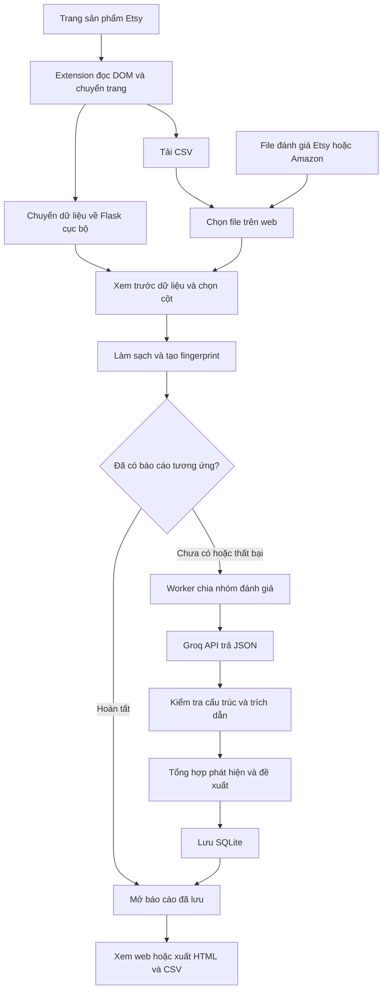
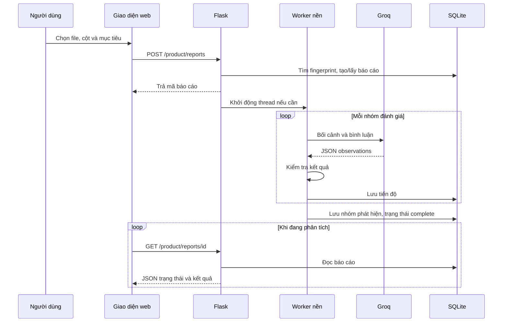

# Product Insights — Phân tích đánh giá để cải tiến sản phẩm

Ứng dụng web phân tích đánh giá khách hàng bằng AI, giúp doanh nghiệp xác định **điểm mạnh cần duy trì, vấn đề cần xử lý và yêu cầu của khách hàng**, sau đó đề xuất hành động cùng cách kiểm chứng hiệu quả. Mỗi phát hiện gắn với trích dẫn từ bình luận gốc để người sử dụng đối chiếu.

Đề tài: **Xây dựng hệ thống phân tích đánh giá của khách hàng bằng Trí tuệ nhân tạo nhằm cải tiến chất lượng sản phẩm tại Công ty Vinazon.**

- Sinh viên: Lê Quốc Thiên — 23IT.B209 — lớp 23SE5.
- Giảng viên hướng dẫn: ThS. Trịnh Thị Ngọc Linh.
- Đơn vị thực tập: Công ty thương mại và dịch vụ VINAZON.
- Người hướng dẫn tại đơn vị: Lê Thị Khánh.

Repo bao gồm mã nguồn Flask, giao diện, tiện ích lấy đánh giá Etsy và các bài kiểm tra. Khóa API, database đang sử dụng và bình luận thật của khách hàng không được đưa vào repo. Dữ liệu ví dụ trong `examples/` là dữ liệu tự tạo.

## 1. Chức năng chính

| Chức năng | Mô tả |
|---|---|
| Nhập dữ liệu | CSV UTF-8, Excel `.xlsx/.xls`, JSON hoặc TXT; xem trước và chọn cột chứa bình luận |
| Làm sạch | Loại dòng trống, trùng, URL hoặc dữ liệu không phải câu nhận xét |
| Phân tích AI | Gửi từng nhóm đánh giá đến Groq; mô hình mặc định `openai/gpt-oss-120b` |
| Tổng hợp | Phân nhóm chất lượng, thiết kế, cá nhân hóa, đóng gói, giao hàng, giá trị, dịch vụ và khía cạnh khác |
| Đề xuất cải tiến | Đưa ra hành động và cách đo/kiểm chứng; hiển thị bình luận liên quan |
| Báo cáo | Xem lại báo cáo, xuất HTML để in PDF, CSV kế hoạch hoặc ZIP đầy đủ dữ liệu |
| Quản lý database | Admin xem bảng, sửa phần diễn giải/đề xuất và xóa từng bản ghi |
| Extension Etsy | Đọc đánh giá của sản phẩm đang mở, thử chuyển trang, tải CSV hoặc chuyển về web |

**Phạm vi:** Có thể nhập file đánh giá từ Etsy hoặc Amazon khi file có cột nội dung phù hợp. Extension trong repo **chỉ hỗ trợ Etsy**, chưa triển khai bộ lấy đánh giá Amazon. Số đánh giá thực tế lấy được phụ thuộc trang, phiên truy cập và cấu trúc giao diện Etsy; không bảo đảm luôn lấy đủ 30.

## 2. Công nghệ

- **Backend:** Python, Flask, Flask-Login, Flask-SQLAlchemy.
- **AI:** Groq Python SDK; prompt yêu cầu đầu ra JSON và trích dẫn nguyên văn.
- **Dữ liệu:** pandas, SQLite; báo cáo lưu JSON trong cột `payload`.
- **Frontend:** HTML, CSS, JavaScript, Jinja2; giao diện nền dùng Tailwind CSS và Bootstrap Icons qua CDN.
- **Extension:** JavaScript, HTML/CSS, Chrome Extension Manifest V3; sử dụng DOM của tab Etsy.
- Một số thư viện NLP và biểu đồ còn được giữ để tương thích với phần phân tích cảm xúc của mã nguồn ban đầu.

Đây là ứng dụng gọi mô hình đã có qua API, **không tự huấn luyện một mô hình AI mới**. Groq là nhà cung cấp API; `openai/gpt-oss-120b` là tên mô hình được cấu hình.

## 3. Cài đặt và chạy trên Windows

Môi trường đã chạy dự án: **Python 3.10.11**. Cần Git, Python có `pip`, kết nối Internet và Groq API key. Không cần cài XAMPP hay SQLite riêng: Python có sẵn module `sqlite3`.

### Bước 1 — Tải mã nguồn và tạo môi trường

Mở PowerShell:

```powershell
git clone https://github.com/LQT23072005/AI_analyzerFeedback.git
cd AI_analyzerFeedback
py -3.10 -m venv venv
.\venv\Scripts\python.exe -m pip install --upgrade pip
.\venv\Scripts\python.exe -m pip install -r requirements.txt
```

Nếu dùng Python phù hợp đã có sẵn, có thể thay `py -3.10` bằng `python`. Các lệnh bên dưới gọi thẳng Python trong venv, không yêu cầu kích hoạt venv hay đổi ExecutionPolicy.

### Bước 2 — Tạo cấu hình

```powershell
Copy-Item .env.example .env
.\venv\Scripts\python.exe -c "import secrets; print(secrets.token_hex(32))"
```

Mở `.env`, điền key lấy tại [Groq Console](https://console.groq.com/keys), và dùng chuỗi vừa tạo cho `FLASK_SECRET_KEY`:

```dotenv
GROQ_API_KEY=your_actual_groq_key
GROQ_MODEL=openai/gpt-oss-120b
FLASK_SECRET_KEY=your_generated_random_secret
```

Luồng báo cáo sản phẩm chỉ cần **Groq API key**; không cần Gemini key. Hạn mức và phí API thuộc tài khoản nhà cung cấp, độc lập với tài khoản ChatGPT. `.env` đã được loại trừ trong `.gitignore`.

### Bước 3 — Chuẩn bị dữ liệu NLTK và chạy

```powershell
.\venv\Scripts\python.exe -m nltk.downloader punkt stopwords wordnet
.\venv\Scripts\python.exe app_enhanced.py
```

Mở [http://127.0.0.1:5000/product](http://127.0.0.1:5000/product). SQLite và tài khoản quản trị mặc định được tạo khi chạy entry point này. Dừng server bằng **Ctrl+C**.

Tài khoản quản trị mặc định trong bản demo: `admin` / `admin123`. Đây là cấu hình chạy thử trên máy cá nhân. Không công khai server hoặc dùng tài khoản này trên môi trường triển khai thật. Giao diện Database yêu cầu đăng nhập admin; các route báo cáo sản phẩm hiện phục vụ theo mô hình sử dụng cục bộ và chưa phân quyền báo cáo theo từng người dùng. Flask đang bật debug, không phải cấu hình production.

### Linux/macOS

```bash
python3 -m venv venv
./venv/bin/python -m pip install -r requirements.txt
cp .env.example .env
# Điền các giá trị trong .env trước khi chạy
./venv/bin/python -m nltk.downloader punkt stopwords wordnet
./venv/bin/python app_enhanced.py
```

Extension được hướng dẫn và sử dụng chính với Cốc Cốc trên Windows.

## 4. Cách phân tích file

1. Vào trang **Sản phẩm** (`/product`).
2. Nhập bối cảnh vào **Sản phẩm và mục tiêu**, ví dụ: “Quà tặng khắc tên; cần cải thiện đóng gói và thời gian giao hàng”.
3. Chọn file, có thể dùng `examples/reviews_demo.csv` để thử.
4. Chọn đúng **cột chứa lời đánh giá**, kiểm tra các câu xem trước. Không chọn cột tên, ngày hoặc mã sản phẩm.
5. Nhấn **Tìm cơ hội cải thiện sản phẩm**, giữ server chạy và theo dõi tiến độ.
6. Xem các nhóm phát hiện, mở **Bình luận từ khách hàng** và hành động đề xuất.
7. Chọn xuất kế hoạch CSV, ZIP dữ liệu hoặc báo cáo dễ đọc. Muốn PDF: mở báo cáo HTML, dùng **Ctrl+P → Save as PDF**.

### Định dạng file khuyến nghị

```csv
feedback_text,rating,review_date,source_url,listing_id,source_page,review_id,product_variant
"The engraving is clear but the box arrived damaged.",3,2026-01-10,https://www.etsy.com/listing/1234567890/demo,1234567890,1,demo-01,Walnut
```

- Cột bắt buộc: một cột nội dung bình luận. Tên dễ nhận diện: `feedback_text`, `review`, `review_text`, `comment`, `feedback` hoặc `nội dung đánh giá`.
- Các cột khác là tùy chọn. Thiếu số sao/ngày/link thì báo cáo để trống, không tự suy ra.
- Có thể dùng `asin` làm mã sản phẩm khi nhập dữ liệu Amazon.
- TXT: mỗi dòng là một bình luận. JSON: dạng mảng các đối tượng có cấu trúc bảng.
- Giới hạn: **16 MB/file**, tối đa **1.000 đánh giá hợp lệ/báo cáo**, mỗi đánh giá tối đa **12.000 ký tự**.
- Không bắt buộc 30 đánh giá; có thể phân tích 14 hay số lượng khác nếu nội dung hợp lệ. Nên dùng một sản phẩm cho mỗi file.

## 5. Cài và dùng extension Etsy

Thư mục cần cài: **`etsy-review-collector/`**, nơi có `manifest.json`.

1. Mở Cốc Cốc, truy cập `coccoc://extensions`.
2. Bật **Chế độ dành cho nhà phát triển / Developer mode**.
3. Nhấn **Tải tiện ích đã giải nén / Load unpacked**, chọn thư mục trên.
4. Ghim extension nếu muốn, mở trang sản phẩm Etsy.
5. Bấm icon extension, nhập link sản phẩm, số đánh giá muốn lấy (ví dụ 30), nhấn **Mở sản phẩm và bắt đầu**.
6. Theo dõi bảng tiến độ trên trang. Extension cố mở phần đánh giá của đúng sản phẩm và chuyển trang. Nếu không mở được, tự mở **View all reviews for this item**, rồi bấm **Tiếp tục** trong bảng tiến độ.
7. Nếu bị yêu cầu xác minh, tự hoàn tất trong trình duyệt. Giữ tab mở trong khi thu thập.
8. Chọn **Tải CSV** để lưu; hoặc chạy web Flask trước, rồi nhấn **Chuyển sang phân tích** để chuyển dữ liệu tới `http://127.0.0.1:5000`.
9. Trên web, kiểm tra cột/nội dung và bấm phân tích. Chuyển dữ liệu từ extension **chưa tự gọi AI**.

Nếu dừng sớm, xem số lượng thực tế; có thể chuyển trang đánh giá thủ công rồi bấm Tiếp tục. Nếu mã đọc không khớp giao diện Etsy, cần cập nhật bộ chọn DOM. Popup có **Lấy thông tin sửa lỗi** và chức năng tải `etsy-page-debug.json`; nên kiểm tra nội dung trước khi chia sẻ vì có thể chứa thông tin đang hiển thị trên trang.

Sau khi cập nhật mã extension: bấm **Reload** tại trang quản lý extension, rồi **F5 tab Etsy**. Dữ liệu tiến độ nằm trong tab; nên tải CSV trước khi đóng/tải lại tab.

Extension không sử dụng Etsy API riêng, không tự giải CAPTCHA và không đổi IP. Không có API key trong extension. Phải có quyền sử dụng dữ liệu và tuân thủ điều kiện của trang nguồn.

## 6. Luồng hoạt động tổng thể



### Luồng phân tích trong Python

```text
read_file() → clean_reviews() → create() → worker()
    → analyze_batch() → call_json() → validate_observations()
    → aggregate() → save()
```

| Hàm trong `product_improvement.py` | Nhiệm vụ |
|---|---|
| `read_file()` | Đọc nội dung file thành DataFrame |
| `clean_reviews()` | Loại dữ liệu không phù hợp và giữ thông tin nguồn |
| `create()` | Tính SHA-256 fingerprint, tìm báo cáo cũ, tạo report và khởi động thread |
| `worker()` | Điều phối phân tích, chia nhóm, cập nhật tiến độ và trạng thái |
| `analyze_batch()` | Phân tích một nhóm, thử lại khi kết quả JSON không đạt kiểm tra |
| `call_json()` | Gọi Groq, đọc JSON, xử lý giới hạn API hoặc lỗi kết nối |
| `validate_observations()` | Kiểm tra ID, trường dữ liệu và trích dẫn nguyên văn có trong bình luận |
| `aggregate()` | Gom theo loại phát hiện/khía cạnh, đếm đánh giá duy nhất và xếp ưu tiên |
| `save()` / `load()` | Lưu/đọc báo cáo SQLite |

Worker gọi `save()` cả khi cập nhật tiến độ, hoàn tất hoặc thất bại. Mỗi nhóm thường tối đa **4 đánh giá**, hoặc được tách sớm khi tổng nội dung vượt ngưỡng 6.000 ký tự; một bình luận riêng vẫn có thể dài hơn ngưỡng nhóm. 30 đánh giá ngắn thường cần 8 lần gọi ban đầu, chưa tính thử lại.

Ứng dụng gửi bối cảnh và danh sách `{id, text}` theo nhóm tới Groq. Không tạo file JSON tạm để upload: JSON là dạng dữ liệu trong yêu cầu/phản hồi. Bình luận được đánh dấu là dữ liệu không tin cậy trong prompt. Đầu ra cần có trích dẫn nguyên văn, nhưng kiểm tra này **không chứng minh mọi cách diễn giải của AI đều chính xác**; người dùng cần đối chiếu.

### Trình tự cập nhật báo cáo



### Cách đọc kết quả

- Mỗi nhóm có loại `strength` (điểm mạnh), `issue` (vấn đề) hoặc `request` (yêu cầu).
- Tỷ lệ = số đánh giá duy nhất nhắc nhóm / tổng đánh giá hợp lệ. Một đánh giá có thể thuộc nhiều nhóm, không cộng các tỷ lệ để suy ra 100%.
- Ưu tiên: nhóm có phát hiện mức `high` → **Cao**; nếu không, có từ 3 đánh giá → **Vừa**; còn lại → **Theo dõi**. Điểm mạnh được trình bày theo hướng duy trì.
- Hành động và cách đo là đề xuất để doanh nghiệp xem xét, chưa phải cải tiến đã thực hiện hoặc KPI đã chứng minh.
- Không có vấn đề trong tập bình luận không đồng nghĩa sản phẩm không có lỗi.

## 7. Database và trang quản trị

| File tạo khi chạy | Nội dung |
|---|---|
| `product_reports.db` | Báo cáo sản phẩm trong bảng `product_reports` |
| `feedback_analyzer.db` | Tài khoản `user` và dữ liệu các chức năng cũ |
| `database_backups/` | Bản sao database trước thao tác sửa/xóa qua trang Database |

Bảng báo cáo:

```sql
CREATE TABLE product_reports (
    id TEXT PRIMARY KEY,
    fingerprint TEXT UNIQUE,
    payload TEXT NOT NULL
);
```

`payload` là chuỗi JSON chứa đánh giá gốc, metadata, nhóm phát hiện, hành động và tiến độ. SQLite chứa JSON trong một cột, không tự biến mỗi thuộc tính thành một cột bảng.

`fingerprint` là SHA-256 của bối cảnh và danh sách nội dung đánh giá đã sắp xếp. Cùng dữ liệu và bối cảnh sẽ mở lại báo cáo phù hợp, tránh gọi AI trùng. Đổi tên file hoặc thứ tự dòng không tự tạo fingerprint mới. Đây là hàm băm nhận diện dữ liệu, không phải mã hóa có thể giải mã. Báo cáo thất bại có thể được chạy lại khi gửi cùng dữ liệu.

Đăng nhập tại `/login`, dùng tài khoản admin, rồi vào **Database** (`/database`):

1. Chọn database và bảng, dùng Xem/Sửa/Xóa trên từng dòng.
2. Báo cáo cho sửa tên file, bối cảnh, diễn giải phát hiện, đề xuất và cách kiểm chứng; giữ nguyên đánh giá nguồn, trích dẫn và số liệu.
3. Sửa nội dung không tự gọi lại AI, báo cáo được đánh dấu đã chỉnh tay.
4. Không sửa/xóa báo cáo đang chạy. Khóa chính và password hash không chỉnh qua giao diện.
5. Trang có kiểm tra quyền admin, token CSRF, phiên bản bản ghi và bảo vệ tài khoản admin đang đăng nhập. Trước khi ghi, database được sao lưu.

## 8. Xuất báo cáo

- **HTML:** báo cáo dễ đọc, có thể in PDF qua trình duyệt.
- **CSV kế hoạch:** mỗi hành động một dòng, có cột người phụ trách, hạn thực hiện và trạng thái để doanh nghiệp bổ sung.
- **ZIP:** `00_thong_tin_bao_cao.csv`, `01_tong_quan.csv`, `02_ke_hoach_cai_thien.csv`, `03_bang_chung.csv` (bình luận/trích dẫn liên quan), `04_danh_gia_goc.csv`.

Các CSV dùng UTF-8 BOM để mở thuận tiện trong Excel. Metadata được giữ nếu đầu vào có; không tự tạo số sao, ngày hay biến thể còn thiếu. Ô có nguy cơ được phần mềm bảng tính hiểu thành công thức được xử lý khi xuất.

## 9. Cấu trúc repo

```text
AI_analyzerFeedback/
├── app_enhanced.py            # Entry point Flask, tài khoản, đăng ký các module
├── product_improvement.py     # Đọc file, phân tích AI, tổng hợp, lưu báo cáo
├── report_exports.py          # Chuẩn bị báo cáo và các file CSV
├── database_admin.py          # API/giao diện quản lý SQLite cho admin
├── web_review_import.py       # Cầu nối dữ liệu extension → web cục bộ
├── config.py                  # Cấu hình từ biến môi trường
├── models.py                  # Model SQLAlchemy cho tài khoản
├── database.py                # DatabaseManager cho chức năng cũ
├── templates/                 # Giao diện Jinja2, JavaScript và CSS
├── etsy-review-collector/
│   ├── manifest.json          # Quyền và cấu hình extension
│   ├── popup.html             # Giao diện popup
│   ├── popup.js               # Xử lý nhập link/số lượng và chẩn đoán
│   ├── background.js          # Điều phối tab và gửi dữ liệu về Flask
│   └── collector.js           # Đọc DOM, phân trang, tải CSV
├── examples/reviews_demo.csv  # Bình luận tự tạo để thử
├── tests/                     # Kiểm tra dùng dữ liệu tạm và API giả lập
├── requirements.txt
├── .env.example
└── LICENSE                    # Giữ giấy phép MIT của mã nguồn nền
```

## 10. Kiểm tra và xử lý lỗi

Chạy kiểm tra không gọi AI thật, không chỉnh database thực tế:

```powershell
.\venv\Scripts\python.exe -m unittest discover -s tests -v
```

Các kiểm tra bao phủ làm sạch, trích dẫn, tổng hợp, worker, xuất báo cáo, cầu nối extension và quyền/sửa/xóa/sao lưu database. Bộ kiểm tra không chứng minh bộ chọn DOM luôn khớp trang Etsy đang chạy.

| Hiện tượng | Cách xử lý |
|---|---|
| `APIConnectionError` | Kiểm tra mạng tới Groq; code có thử lại hữu hạn. Không yêu cầu đủ 30 đánh giá mới được phân tích |
| HTTP 429 | Chờ hạn mức API hồi phục, tránh bấm phân tích liên tục; code có chờ/thử lại |
| Model không tồn tại/không có quyền | Kiểm tra `GROQ_MODEL` và quyền truy cập của tài khoản Groq |
| Không có JSON hoặc JSON sai | Code kiểm tra và thử lại; nếu vẫn lỗi, báo cáo chuyển failed, không tạo kết quả thay thế giả |
| Chọn nhầm ngày thay cho bình luận | Xem trước dữ liệu, chọn lại cột nội dung |
| Extension không chuyển trang | Mở phần đánh giá, thử chuyển thủ công/Tiếp tục; tải dữ liệu đã lấy và chẩn đoán DOM |
| Không chuyển dữ liệu sang web | Chạy Flask tại `127.0.0.1:5000` trước khi bấm chuyển |
| `favicon.ico` trả 404 | Chỉ thiếu icon tab, không phải lỗi phân tích |
| `LegacyAPIWarning` | Cảnh báo API SQLAlchemy cũ ở phần tài khoản, không tự đồng nghĩa báo cáo thất bại |

Worker hiện dùng thread nền và khóa trong một process; chưa có hàng đợi bền vững hoặc tự khôi phục công việc sau khi server tắt. Không sửa mã/khởi động lại server giữa lúc phân tích vì debug reloader có thể ngắt thread. Phân tích mới cần mạng và Groq; báo cáo đã lưu có thể xem lại mà không gọi AI.

## 11. Nguồn gốc và giấy phép

Dự án được phát triển tiếp từ mã nguồn AI Feedback Analyzer có giấy phép MIT (copyright KIRIT P S, 2025), giữ nguyên thông tin trong [LICENSE](LICENSE). Phần phát triển cho đề tài VINAZON chuyển trọng tâm sang cải tiến sản phẩm, bổ sung luồng báo cáo có trích dẫn, xuất dữ liệu, quản trị SQLite và extension Etsy. Các chức năng cũ còn trong mã nguồn nhằm giữ tương thích; các trang điều hướng chính hiện đưa về `/product`.
